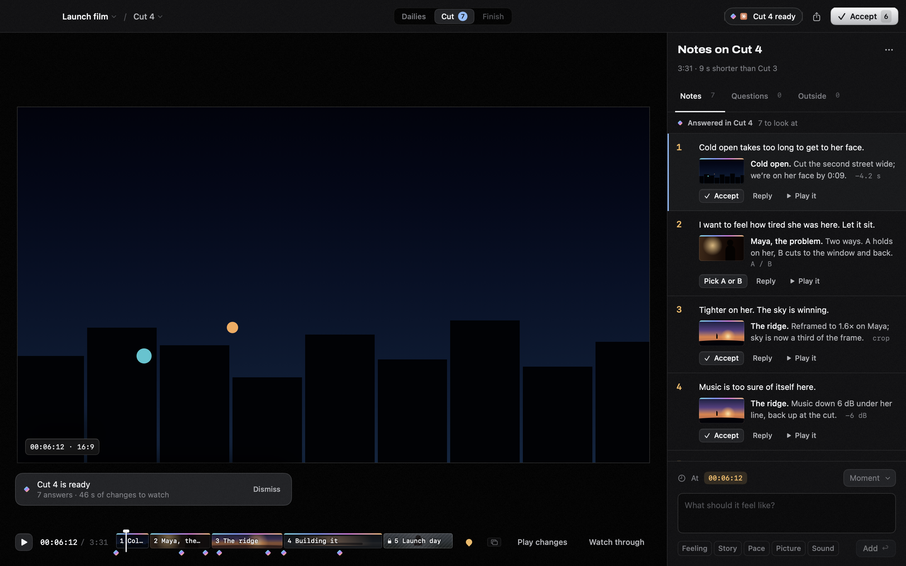

# Direction

Direction is a Mac app for directing a film while an editor cuts it. The editor is Claude Code or Codex running on your Mac with Direction's tools. You work the way you would with a human editor: write the brief, bring in footage, circle takes, then watch cuts and give notes. The editor logs the footage, cuts each version, answers your notes and finishes the film. You never touch a timeline.

Direction runs on your Mac. The editor works through your own Claude or ChatGPT plan, and OpenRouter is used only if you add a key. Films are folders ending in `.direction`, kept in `~/Movies/Direction` unless you choose another folder. Your original footage is linked, never changed.



## Download

**[Download Direction for Mac](https://updates.givedirection.ai/Direction.dmg)** (Apple Silicon, macOS 26 or later). Open the DMG, drag Direction to Applications, and open it from there. It's signed and notarized by Apple, and it checks for updates once a day and asks before installing one.

Then sign in one editor, as below. To build it yourself instead, see [Build and open](#build-and-open).

## What you need

- A Mac with Apple Silicon, running macOS 26 or later.
- One editor, not both:
  - [Claude Code](https://claude.com/claude-code), signed in with your Claude account:
    ```sh
    curl -fsSL https://claude.ai/install.sh | bash
    claude        # sign in once, then quit
    ```
  - Or [Codex](https://github.com/openai/codex), signed in with ChatGPT:
    ```sh
    npm install -g @openai/codex
    codex login
    ```

## Build and open

To build from source you also need Xcode 26 or later. Direction is built and tested with Xcode 27.2 (Swift 6.4); older versions haven't been tried. If you've never opened Xcode, open it once so it finishes setting up.

```sh
git clone https://github.com/Hendrixer/Direction-app.git
cd Direction-app
./scripts/build-app.sh release
open build/Direction.app
```

The first build downloads four Swift packages (GRDB, the MCP Swift SDK, Swift Argument Parser and Sparkle) and takes a few minutes. A copy you build is signed for your own Mac only and doesn't update itself: to update, quit Direction, run `git pull`, then run `./scripts/build-app.sh release` again. Use it instead of a downloaded copy, not beside one, since both share the same library and settings.

Releases are made with `scripts/release.sh` (see [releasing](docs/releasing.md)).

## Making a film

1. **File › New Film…** (or New Film from a Script / from a Story). Write the brief: what the film is, how it should feel, and its shape (16:9, 9:16, 1:1, 4:5, or as shot). **Film › Brief…** (⌘B) opens it again later.
2. **Who's editing?** Each new film asks which program edits it: Claude Code or Codex (your last choice is already picked). Direction starts it with your own sign-in whenever the film has work, and you can pause or stop it at any time. Then add footage.
3. **Dailies.** The editor logs every take. Circle the ones you want.
4. **Cut.** The editor cuts an assembly. Watch it, write notes, then turn them over. The editor reads your notes back to you, cuts the next version and answers each note. Play changes shows only what changed.
5. **Finish.** Lock picture, then deliver a master, a web copy and captions.

**Script** and **Breakdown** are for when you start from a script or story. The editor writes an A/V script, and the breakdown lists what to shoot.

Settings › Engines › Who edits changes the open film's editor and the one new films start with. Each film's speed and quality (Faster · Balanced · Best, in the editor popover) sets the version and effort for each job and the version for each made request; see [speed and quality](docs/speed-and-quality.md).

## Do I need API keys?

No. Nothing in this repo holds a key, and the main work needs none:

| What | What it needs | Where |
|---|---|---|
| The editor | Your Claude Code or Codex sign-in. No API key; the editor uses your plan. | Run `claude` or `codex login` once in Terminal |
| Transcription | Nothing. Apple's on-device speech is used (macOS may download its language model the first time). | Settings › Engines › Transcription |
| Cutting, color, sound, titles, graphics, export | Nothing. All of it runs on your Mac. | — |

Optional extras:

| Extra | What it needs | Where |
|---|---|---|
| Whisper transcription (tighter word timing) | `pip install mlx-whisper` and `brew install ffmpeg` | Settings › Engines › Transcription |
| Describing shots on this Mac, so the editor can find "the wide of the window" | `uv tool install mlx-vlm`, then download a model from Settings | Settings › Engines › Looking at footage |
| Making shots, stills and music, or describing shots online | An [OpenRouter key](https://openrouter.ai/keys). Paid per use; you set spending limits in Settings. | Settings › Engines › OpenRouter |
| Videos from links, for a style or a technique | Nothing: Direction gets [yt-dlp](https://github.com/yt-dlp/yt-dlp) from its GitHub releases the first time and keeps it up to date. YouTube works best with [Deno](https://deno.com) (`brew install deno`). Or drop the video file in instead. | Film › Learn a Technique…, or a style from a video |

A key you paste in Settings is kept in your Mac's keychain. It's never written into a film or this repo, and the editor never sees it.

## Running your own editor session (optional)

You don't need this: Direction starts the editor itself. If you'd rather drive Claude Code or Codex yourself, choose "I'll run my own session instead" in Who's editing?, then install Direction's tools:

```sh
./scripts/install-local.sh                      # links ~/.local/bin/direction
claude --plugin-dir "$PWD/plugins/direction"    # or see docs/plugins.md for Codex
```

Direction then shows what your session does, but it can't start, pause or stop it.

## Development

```sh
swift build           # or open Package.swift in Xcode
./scripts/test.sh     # every test: Swift tests, then CLI, JSON API and MCP checks
```

`scripts/test.sh` takes several minutes. It keeps its library, caches, logs, styles and techniques under `build/verification/`, so it doesn't touch `~/Movies/Direction`. The tests make their own video, so they need no footage and no keys.

| Folder | What's there |
|---|---|
| `Sources/DirectionCore` | Films, edits, notes, cuts and locks, stored in SQLite (GRDB) |
| `Sources/DirectionMedia` | Playback, Metal/Core Image rendering, export, transcription |
| `Sources/DirectionTools` | The tools the editor uses over MCP |
| `Sources/DirectionApp` | The SwiftUI app |
| `Sources/DirectionCLI` | The `direction` command: CLI, JSON line API and MCP server |
| `plugins/direction` | The skills the editor follows, and the plugin for your own sessions |
| `design/spec` | The product spec: every room and screen, and the Gate design system |
| `docs` | [Architecture](docs/architecture.md), [the agent contract](docs/agent-contract.md), [editor runs](docs/editor-runs.md), [verification](docs/verification.md), [releasing](docs/releasing.md) |

## Limits

- Apple Silicon and macOS 26 or later only. Intel Macs haven't been tried.
- Delivery is SDR Rec.709. HDR footage (an iPhone's HLG, for example) is copied to SDR inside the film; the original stays as it is.
- Screening links aren't available yet. To share a cut, export a screening copy with File › Share Cut….
- Open-source parts are listed in [THIRD_PARTY_NOTICES.md](THIRD_PARTY_NOTICES.md).
