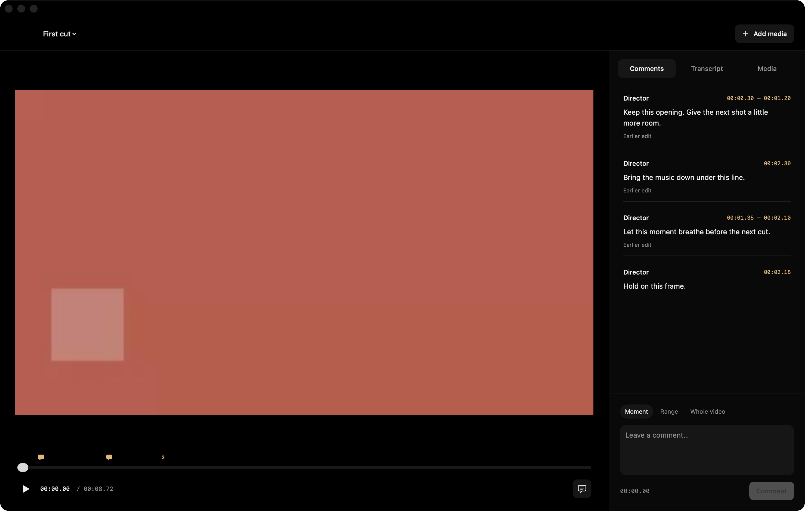

# Direction

A native Mac video editor for an external agent and a human director. Import footage, make edits through local tools, review the result, and leave feedback that the agent can inspect with the original picture, audio, transcript, and source context.

**Version 0.2** includes a working SwiftUI/AppKit app, shared native editing engine, CLI, JSON line API, and official MCP stdio server. There is no embedded chatbot or cloud service.



## Build and open

Requires Apple Silicon, macOS 26 or later, and Xcode 26 or later with Swift 6.2+. Development and verification used Xcode 27.1 / Swift 6.4 on an M4 Max.

```sh
./scripts/build-app.sh release
open build/Direction.app
```

The script builds and ad-hoc signs a local app containing both executables. It is not a notarized distribution build. Open `Package.swift` in Xcode to work on the sources.

```sh
CLI="$PWD/build/Direction.app/Contents/Helpers/direction"
"$CLI" create "$HOME/Movies/My edit.direction" --name "My edit"
"$CLI" import /absolute/path/footage.mov --project "$HOME/Movies/My edit.direction" --append
open build/Direction.app --args --project "$HOME/Movies/My edit.direction"
```

Use the project menu for **New Project**, **Open Project**, and recent projects; use **Add media** to import footage. The first import is appended automatically; later sources remain in the media library until added to the cut. Originals are linked and never modified.

## What works

- Jet-black native viewer, one seek bar with clickable comment markers, and Comments / Transcript / Media panels. No manual layer timeline, color, audio, or export controls in the director UI.
- Atomic programmatic insert, trim, split, move, remove, speed, layering, title, framing, canvas, color, and audio edits.
- Metal/Core Image compositing shared by playback, frame sampling, and export. Native H.264, HEVC, and ProRes export.
- Moment, range, whole-cut, and frame-region feedback pinned to an immutable edit revision. Agents can fetch inline PNG frames and WAV audio through MCP.
- Local Apple SpeechAnalyzer transcription. In **Transcript**, select words to remove their footage, or delete text and apply the change. Ambiguous repeated words require exact word selection.
- Agent tools for independent mute/gain on every embedded source audio track, plus per-clip overrides. Native EQ, compression, limiter, and fades.
- Landscape, portrait, and square sequences; supplied B-roll, still images, titles, and separate audio. Source-timed transcript cuts ripple across all layers.
- The app observes external edits. A playing review stays on its current revision until you load the update; paused playback refreshes automatically.

In-app feedback does not wake an agent. On the next request, the agent reads `direction_feedback` and uses `direction_feedback_context` to inspect the original footage before editing.

## Connect an agent

The shared [Direction plugin](plugins/direction) includes Codex and Claude Code manifests, MCP wiring, and three skills: start-project, edit-video, review-feedback. See [installation](docs/plugins.md).

```sh
./scripts/install-local.sh
```

The server starts without a project. Use `direction_projects`, `direction_create_project`, or `direction_open_project`, then pass the returned `projectPath` on subsequent calls. The app and tools share a recent-project index. For manual MCP configuration:

```json
{
  "mcpServers": {
    "direction": {
      "command": "/absolute/path/Direction.app/Contents/Helpers/direction",
      "args": ["mcp"]
    }
  }
}
```

`direction tools` prints all schemas. `direction call TOOL --file arguments.json` exposes every MCP operation through the CLI. Pass `projectPath` in JSON or use a fixed `--project PATH`. `direction api` (optionally `--project PATH`) serves the same operations as newline-delimited JSON on stdin/stdout. The app does not need to be open for these tools to work.

See [the agent contract](docs/agent-contract.md) for exact edit examples, job handling, transcript edits, and multimodal feedback.

## Tests

```sh
./scripts/test.sh

# Optional real on-device recognition test; first use may download Apple's model.
python3 scripts/test-speech.py "$(swift build --show-bin-path)/direction" build/verification
```

Tests generate their own native video with two distinguishable audio streams. They inspect real rendered pixels, decoded audio, and exported media, and exercise CLI/API/MCP as external processes. No FFmpeg or user footage is required. Reports and reusable fixtures are written under `build/verification/`.

## Current boundaries

This is an initial local editor. SDR Rec.709 is the delivery target; HDR video is rejected explicitly. Text edits delete existing speech; they do not generate new speech. Multi-camera footage can be aligned and layered through tools, but automatic camera synchronization and a multicam switcher are not included. Audio exports are mixed down. There is no generative footage, cloud review, automatic pause removal, subtitle export, transitions, advanced color scopes/LUT workflow, or proxy manager yet.

Large-project/4K throughput and Intel compatibility have not been qualified. Keep linked sources available and unchanged. Jobs run in their starting app/API/MCP process and are marked interrupted if that process exits; they do not survive as background services. Speech recognition runs on-device after Apple's language model is installed.

- [Architecture and persistence](docs/architecture.md)
- [Product and UI behavior](docs/product-and-ux.md)
- [Verification record](docs/verification.md)
- [Relevant open-source dependencies](THIRD_PARTY_NOTICES.md)
