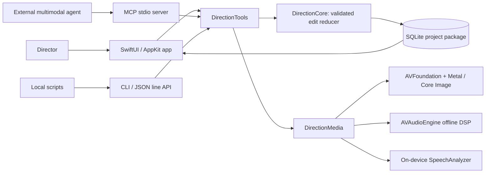

# Implemented architecture · v0.2

Direction is a native local app and command-line host backed by the same Swift packages. This document describes the implementation. The original planning document is preserved in `archive/architecture-proposal.md`.

## Process and package boundaries

- **DirectionCore:** rational media time, source/clip/sequence models, edit reduction, transcript alignment, review anchoring, SQLite transactions.
- **DirectionMedia:** source inspection, native compositions, GPU compositor, sample extraction, audio DSP, local speech, preview and export.
- **DirectionTools:** one validated operation catalog and runtime; structured responses; jobs; official MCP Swift SDK adapter.
- **DirectionCLI:** ArgumentParser commands, generic tool calls, line-delimited JSON server, MCP server entry point.
- **DirectionApp:** one native workspace with AVPlayerView, review controls, feedback, transcript editing, and limited finishing controls.

**Deliberate v0.1 choice:** the app and CLI/MCP are separate processes using the same library and SQLite transaction rules. There is no app-owned IPC service yet. This makes headless edits possible and avoids requiring the UI to be running. An agent never writes project JSON directly. SQLite serializes writes across processes; every edit checks its expected revision inside the transaction.

## Persistence and concurrency

A `.direction` package contains `manifest.json`, `project.sqlite`, and SQLite's WAL/SHM sidecars while open. Keep the entire package together. Back up or copy it with writers closed; copying the database file alone while writes are active is unsafe.

The database stores current project state, complete immutable edit snapshots, request idempotency records, ordered events, review cuts, comments, timed source transcripts, and jobs. GRDB manages transactions and a ten-second busy timeout. WAL allows concurrent readers. A failed batch commits nothing. An exact `EditBatch` retry returns the original revision without resetting newer work. Reusing its key for different arguments fails.

Media assets store linked paths, file bookmarks where available, size/mtime fingerprints, stream IDs, and technical metadata. Changed or missing sources fail explicitly. Fingerprints detect ordinary file replacement; they are not cryptographic content identity. There is no managed-media copy or relink UI in v0.1.

Caches live in `~/Library/Caches/dev.direction.editor/<projectID>/` and contain thumbnails, PCM/DSP intermediates, render clock media, sampled feedback, and previews. Project history does not depend on cached previews; originals are required to render old cuts. Cache eviction and automatic size limits are future work.

The app polls the event cursor every 350 ms. Committed edits cause recompilation while paused. During playback, it retains the current composition and shows an update button. This avoids changing what a director is reviewing halfway through a comment. Comments and analysis update the event cursor without incrementing `editRevision`.

## Time and editing

Canonical time is `{value: Int64, timescale: Int32}`, converted through CoreMedia rational operations. Ranges are half-open `[start, start + duration)`. Source time and sequence time are distinct; clip speed maps between them.

Each clip has a stable ID, lineage ID, source range, sequence start, kind, layer, speed, grade, framing, and audio overrides. Splitting preserves lineage. Same-kind clips cannot overlap on the same layer. Overlay footage and separate audio use additional layers. The edit reducer supports insert, remove, split, trim, move, speed, color, framing, audio, title, format, rename, and duplicate-sequence operations.

`removeRange` cuts the interval across all layers; ripple shifts later content. Transcript deletion uses this same operation. Clip-level trim/speed ripple moves clips that start after the old clip end; it does not perform automatic multi-camera synchronization or time-stretch a separate voiceover to match a changed camera speed.

## Picture pipeline

AVFoundation decodes source tracks into an AVMutableComposition. A custom AVVideoCompositing implementation receives source pixel buffers and uses a Metal-backed Core Image context. It applies source orientation, fit/fill, scale, translation, opacity, basic color controls, and layer composition. Titles and stills join the same graph. A cached tiny timing track drives frames through gaps and sections containing only stills/titles/audio.

Core Image works in extended linear sRGB with half-float intermediates. Delivery is 8-bit SDR Rec.709. HLG/PQ video is never read as if it were SDR: importing it makes an SDR Rec.709 copy in the film's Footage folder (`SDRCopy`: AVFoundation's tone mapping through a video composition tagged Rec.709, exported as HEVC at the original's size and rate with its sound), the asset's `sdrCopyOf` names the original, and the same original isn't brought in twice. Anything else that reads HDR directly, like studying a reference video, still refuses it. A file with open keyframes (FFmpeg's x265 writes them: the frames shown just before a keyframe are decoded after it, from the group before, while the file says decoding can start at it) stalls AVFoundation wherever playback or a frame starts on one of those frames, so it comes in as a copy too (`SeekableCopy`): the same samples rewritten without re-encoding into a QuickTime movie that marks those keyframes partial, with the original's timing and track IDs, named by the asset's `seekableCopyOf`. The decoder decides which files need it, because Apple's encoders write the same frame types decodable from their keyframe. Takes brought in before this get their copy in place when the film opens, once per file. Exposure, contrast, saturation, temperature, and tint are supported; advanced grading, LUTs, scopes, HDR preservation, RAW, and color-managed mastering are outside this build.

AVPlayerItem, AVAssetImageGenerator, and AVAssetExportSession use the same composition settings. Preview may reduce output dimensions but does not use a different edit graph. Native export supports H.264/HEVC MP4 and ProRes MOV. AVFoundation controls codec acceleration; the application explicitly selects Metal for compositing. CPU work still performs project validation, scheduling, and audio processing.

Exports pin the project snapshot before work starts, write a temporary file beside the destination, then move the finished file into place. Existing destinations and source overwrites are refused. Performance beyond the verified small fixtures is not yet characterized; there is no claim of a tested 4K multicam throughput target.

## Audio and transcription

Every source audio stream keeps its own persistent track ID. Source settings apply to all its clip instances; a clip can override an individual track. Muted tracks are omitted from the mix. AVAudioMix supplies gain and fades. Cached AVAudioEngine offline processing supplies high-pass, bass/treble shelves, DynamicsProcessor compression, and PeakLimiter. Native PCM extraction converts endian/sample-rate differences and preserves source-timeline offsets.

Audio analysis of a source track exposes sample peak, RMS, and waveform peaks; these are not LUFS. The cut's mix, read through the same AVAudioMix the export uses, is measured to ITU-R BS.1770-4 (`LoudnessMeter`): integrated LUFS with both gates, sample peak, and true peak from 4× oversampling, streamed a buffer at a time. Export mixes enabled sources; preserving separate delivery stems is future work.

Transcription runs on-device with the engine chosen in Settings › Engines, stored in the `dev.direction.shared` defaults suite so the app, CLI and MCP server agree. Whisper runs the `mlx_whisper` command (found in ~/.local/bin, Homebrew or the Python user bin) on the extracted 48 kHz track and reads its word timestamps. SpeechAnalyzer transcribes the chosen embedded track on-device. Apple's language asset may download at first use. Timed attributed results become source words. If a result run contains multiple words under one timing range, the implementation divides that range proportionally; timings are recognition estimates, not forced alignment. The most recently transcribed/imported audio track is selected for each asset, while other track transcripts remain stored.

The text panel projects words from transcribed video on layer zero. If none is transcribed, it uses separate audio on layer zero, which supports voiceover beneath supplied picture. It does not combine simultaneous speakers into a dialogue editing UI yet. Deleting exact word IDs avoids ambiguity. Free-text edits must be a deletion-only subsequence; repeated-word ambiguities fail with guidance to select words. No new speech is synthesized.

## Review and multimodal context

Comments pin revision, sequence, optional saved cut, point/range/global scope, and optional normalized frame region (origin top-left). They capture overlapping source/lineage ranges, source audio IDs, and transcript words at creation. Later edits cannot move the original feedback silently.

The context tool reads the original snapshot and renders actual frames and a bounded WAV sample. It also reports current projections as exact, split, removed, or ambiguous. MCP emits both structured JSON text and inline PNG/WAV content. A sampled video is available through `direction_preview`; it returns a local artifact rather than assuming MCP video blocks.

Feedback is fetched on the agent's next request. Agents may reply and mark a note addressed; acceptance is a director action. Saving feedback does not start another agent run.

## Jobs and recovery

Transcription, preview, and export return durable job IDs. Their work belongs to the initiating process. CLI commands wait; persistent API/MCP clients poll. Cancellation reaches the owner task and the native exporter/analyzer where supported. A dead owner's jobs become interrupted when read. There is no background daemon or automatic job restart. Status currently describes phases and completion; export has no fine-grained percentage callback.

## Open-source parts

GRDB provides mature SQLite transaction handling; the official MCP Swift SDK supplies transport and protocol support; Swift Argument Parser provides CLI parsing/help. Native Apple media frameworks handle the platform-specific media pipeline. Package.resolved pins versions and the app includes upstream notices. See `../THIRD_PARTY_NOTICES.md`.

## v0.2 project router and director UI

`ProjectRouter` owns a map of per-project `ToolRuntime` actors. Agent calls use an explicit projectPath or an immutable CLI launch default. Opening a project does not mutate global selection; concurrent work cannot silently switch another call's target. Runtime checks also reject mismatched project paths. A shared GRDB project library indexes explicitly opened packages and supports native recents.

The director sees Comments, Transcript, and Media beside the native viewer. `ReviewTimeline` is now only a playback scrubber with comment markers. Source anchors project older comments onto surviving footage; removed/ambiguous anchors remain accessible in the list without a misleading marker. Clicking a marker opens the original reviewed revision. All finishing/export capabilities remain in the engine and tool catalog.

Theme.swift owns native semantic colors, dimensions, and shared button treatments. There is no React/WebView rendering layer. The plugin is one portable folder with separate Codex and Claude compatibility manifests sharing MCP wiring and skills.
