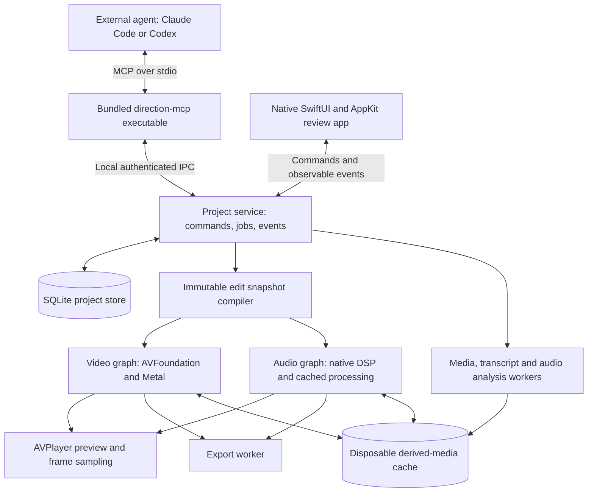

> Historical architecture proposal, superseded by the current documentation one directory above. This describes intended scope, not shipped capabilities.

# Technical architecture

Status: proposed design, not an implemented or benchmarked system. Confirmed requirements and provisional product choices are in [product and UX](product-and-ux.md).

## Architecture decision

Build a native Swift application with a headless-capable editing domain, a GPU-backed media pipeline, and a local MCP adapter. The application and the agent call the same command service. Neither edits an independent copy of the project.

For the first implementation, the running app owns the project service and persistent store. The MCP helper can launch the app and reconnect to it. Export and analysis jobs can continue if the client disconnects, while the app remains running. Running all jobs after the app quits would require a separately managed service and is a later lifecycle decision.



The IPC transport, render graph, and job model are implementation boundaries, not separate network services. Start with a modular application; introduce worker processes where profiling, crash isolation, or cancellation warrants them.

## Native application

Proposed baseline: Apple Silicon and macOS 26+, Swift 6, SwiftUI for app structure and review panels, AppKit integration for native windows, file handling, and player hosting. Confirm the OS floor before locking dependencies. Use Swift packages for the domain and engine, with an Xcode application target for signing, entitlements, and distribution.

Use Observation for UI state and an event stream from the project service. Keep disk IO, media decoding, transcript analysis, and graph compilation off the main actor. A dedicated project actor serializes mutations; it does not perform expensive frame processing on its executor.

Proposed modules:

| Module | Responsibility |
| --- | --- |
| DirectionCore | Rational time, IDs, media/sequence models, typed commands, validation, snapshot and diff types |
| DirectionStore | SQLite schema, atomic commits, checkpoints, feedback, job records, migrations |
| DirectionEngine | Media ingestion, edit compilation, source-to-sequence mapping, job scheduling |
| DirectionVideo | AVFoundation composition, Metal/Core Image processing, frames and thumbnails |
| DirectionAudio | DSP graph, envelopes, loudness measurements, processed-audio cache |
| DirectionAnalysis | Transcript providers, silence/scene detection, contact sheets and analysis provenance |
| DirectionMCP | MCP schemas, resource serialization, adapter and local IPC client |
| DirectionApp | Review UI, permissions, connection setup and export controls |

These boundaries need not all become separate build targets on day one.

## Video pipeline and hardware

Use AVFoundation for media loading, source timing, composition, and player integration. A custom `AVVideoCompositing` implementation evaluates the visual graph. Apple documents that custom compositors can serve player, export, frame-generator, and reader paths. [AVVideoCompositing](https://developer.apple.com/documentation/avfoundation/avvideocompositing).

Use a persistent Metal device/queue and a Metal-backed `CIContext` for standard filters, with custom Metal kernels for operations that require them. Keep frames in pooled Core Video buffers/IOSurfaces and bridge to Metal textures. Core Image supports Metal rendering, and Core Video exposes texture-cache interop. These APIs make reduced-copy processing possible; they do not prove that the complete pipeline is copy-free. [CIContext](https://developer.apple.com/documentation/coreimage/cicontext), [CVMetalTextureCache](https://developer.apple.com/documentation/corevideo/cvmetaltexturecache-q3j).

Distinguish hardware responsibilities:

- The GPU handles color transforms, effects, scaling, transitions, graphics, and compositing.
- Dedicated media engines handle supported codec decoding/encoding through the native frameworks. Probe device/codec/profile support; do not assume hardware acceleration for every input.
- The CPU handles project logic, scheduling, IO, and appropriate audio/DSP tasks.
- Local ML execution selects a supported compute backend per model. Do not claim Neural Engine acceleration merely because Core ML is present.

Prefer the AVFoundation decode/encode paths first. Use VideoToolbox directly where hardware-session controls or diagnostics justify it. Apple's own guidance says direct VideoToolbox use is unnecessary when applications do not need that level of control. [VideoToolbox](https://developer.apple.com/documentation/videotoolbox).

Do not make shelling out to FFmpeg the primary renderer. A future optional interoperability tool can use it for unsupported formats without redefining project semantics.

### Render contract

Compile an immutable sequence snapshot into a graph covering source selection, timing, transforms, effects, graphics, transitions, audio, and output settings. Playback, frame sampling, and export use the same parameter definitions and graph semantics. Preview may reduce resolution but must not omit edits or alter color/audio decisions.

Define effect order explicitly: source interpretation/input transform → source-space corrections → framing → layer compositing → output transform. Any effect that intentionally operates in another color space declares that boundary. Cache keys include graph hash, asset identity, timing, render quality, color configuration, and engine version.

Core Image or Metal availability is not a performance guarantee. Profile decode, GPU processing, synchronization, frame copies, and encode separately.

### Color

Use an explicit, scene-linear floating-point working pipeline with documented primaries, input transfer functions, and output transforms. Retain source color metadata. Evaluate LUTs in their declared input/output spaces and validate domains.

First-release delivery should target a well-tested SDR Rec.709 pipeline. HDR sources require a deliberate, tested tone-mapping path; unsupported color/log formats must be flagged rather than silently interpreted as Rec.709. Comprehensive HDR mastering remains outside the initial scope.

Build exposure, temperature/tint, contrast, saturation, curves, and LUT support with persisted numeric parameters. The external agent chooses values; the engine provides measurements, frame samples, before/after, and repeatable rendering. “Match these shots” is an agent workflow built on those tools, not a magic parameter without a defined implementation.

### Audio and playback synchronization

Use AVPlayer as the playback clock for the first release. Keep gain/fade envelopes in the native composition audio mix. For EQ, compression, limiting, and supported denoise, render reusable processed-audio segments into a cache using native DSP and offline audio rendering, then reference them in both preview and export. This avoids inventing a second independent live audio clock in the first implementation.

Apple supports offline manual rendering through AVAudioEngine. This supports the proposed processed-audio path, but accurate timeline scheduling, effect latency, tail handling, seek behavior, and export parity still require a technical spike. [Offline audio processing](https://developer.apple.com/documentation/avfaudio/performing-offline-audio-processing).

Changing audio parameters schedules cache invalidation and processing. Until it finishes, identify the pending audio preview rather than presenting old audio as the new result. Batch operations to avoid rerendering an entire long recording for a small change. Ducking envelopes depend on the final dialogue arrangement and must be recalculated after relevant edits.

Use a canonical 48 kHz processing format with explicit conversion and channel mapping. Keep audio positioning sample-accurate, measure integrated loudness and true peak with a validated implementation, and apply a configurable delivery preset. Do not turn each clip up independently and call the overall result normalized. Latency compensation must preserve lip sync through cuts and speed changes.

If processed-audio caching cannot meet interactive latency targets, evaluate a custom synchronized playback engine. Do not take on that complexity until the spike demonstrates a need.

## Persistent project model

A `.direction` project is a package directory containing:

```text
Project.direction/
  manifest.json        # package identity, format version and store location
  project.sqlite       # authoritative project, feedback, history and job metadata
  Media/               # optional managed source media
  Snapshots/           # optional portable snapshot exports, derived from the store
```

Large disposable proxies, processed audio, waveforms, thumbnails, and render caches live in a quota-managed application cache outside the project by default. Store export destinations separately from source media. Checkpoint SQLite/WAL consistently for copying or backing up an open project; never copy only the main database file during a live transaction.

Linked media is the proposed default for fast import; offer managed copying for portability. Track source identity, probe metadata, security-scoped bookmarks when required by the distribution/entitlement model, and background content hashes. Never silently accept a changed source file just because its path is unchanged. A relink requires a checked identity/metadata mapping.

Important entities:

| Entity | Meaning |
| --- | --- |
| Asset | Stable source identity, streams, timing, color/audio metadata and file access |
| Sequence | Output frame rate, canvas, color/audio policy and layered clip arrangement |
| Clip instance | Stable instance ID, asset stream, source span, sequence span, speed mapping and parameters |
| Sync group | Related camera/audio assets with explicit common-time offsets and provenance |
| Edit revision | Immutable sequence state produced by an atomic edit batch, with parent and provenance |
| Review cut | Named immutable reference to an edit revision, playable without requiring a full export |
| Feedback thread | Original cut, scope, rational interval, source anchors, transcript/region context and review status |
| Feedback action | Agent response, affected operations/revision, and director acceptance/reopening |
| Job | Operation, pinned input revision, phase, progress, cancellation and result artifacts |

Use rational `{value, timescale}` media time, half-open intervals, and a rational output frame rate. Store actual source presentation timestamps for variable-frame-rate inputs. Video operations snap according to an explicit frame policy; audio retains sample resolution. Do not use floating-point seconds as the canonical edit model.

The model supports multiple named sequences and arbitrary output canvases, including 16:9, 9:16, and 1:1. The same imported assets can serve long-form, short-form, interview, and screen-recording edits. Camera/audio synchronization is represented explicitly through offsets; read source timecode where present and accept agent-provided offsets. Automatic waveform synchronization needs its own tested analysis implementation. Camera-angle selection is programmatic editing over aligned sources, without requiring a manual multicamera console.

Store a transactionally consistent snapshot and operation log for each committed batch. Undo/restore creates a new revision pointing back to prior content; it never erases history. Keep `editRevision` separate from feedback/event cursors so adding a comment does not invalidate an unrelated edit batch.

## Live updates and concurrency

All app and MCP mutations flow through a single command service. Validate a proposed batch against `baseEditRevision`, apply it atomically, persist the snapshot/log, then publish a committed event. Failed batches leave the previous playable state intact. Stale clients receive a conflict and a diff reference.

Use an in-process event stream to the app and a local Unix-domain socket bridge for the bundled MCP helper. Put endpoint metadata in a per-user private runtime directory, check peer identity, and use a scoped session credential. This is a same-account integration boundary, not isolation from every process running as that user. Exact sandbox/entitlement behavior needs a signed-app spike before distribution choices are locked.

Use monotonic durable event cursors for reconnect/replay, explicit subscription lifetimes, and coalesced view updates. Missed events cause a fresh snapshot fetch. UI state names its displayed revision, playback revision, and pending working revision independently.

Keep long jobs outside write transactions. Jobs pin their inputs; completion cannot overwrite a newer working edit. After app relaunch, interrupted non-resumable jobs report interruption and can be restarted explicitly. Recoverable project edits survive process crashes. Export cancellation removes incomplete output and does not corrupt a prior completed export.

## MCP boundary

Package a `direction-mcp` stdio executable with the app. It translates MCP into project-service commands; it never opens the database for a competing write path. Stdout contains protocol messages only; logs go to stderr. Negotiate protocol versions supported by actual clients rather than requiring a draft-only feature. [MCP transports](https://modelcontextprotocol.io/specification/2025-06-18/basic/transports).

Prefer the [official Swift MCP SDK](https://github.com/modelcontextprotocol/swift-sdk) after a compatibility spike. Use ordinary tools and explicit jobs as the baseline. Notifications and resource subscriptions improve freshness when clients support them; no workflow depends solely on an experimental task extension or client notification causing an AI turn.

For transcription, evaluate Apple's [SpeechAnalyzer](https://developer.apple.com/documentation/speech/speechanalyzer) and [SpeechTranscriber](https://developer.apple.com/documentation/speech/speechtranscriber) behind a provider interface. They are available on macOS 26+, with device/language availability and model-asset checks. Word-level timing quality, long-file handling, offline behavior after model installation, and caption alignment are acceptance criteria; retain a replaceable provider rather than coupling edit semantics to one recognizer.

The app exposes local files chosen/imported for the project and bounded derived-media resources. It provides frames, contact sheets, transcript spans, audio measurements, and rendered samples, so the agent can inspect its work. A file path alone is insufficient visual feedback.

The proposed tool families, feedback payload, and edit transaction semantics are in [agent contract](agent-contract.md).

## Performance design and acceptance gates

Proposed targets require measurement on a baseline M-series Mac as well as the development M4 Max. They are targets, not advertised results:

| Gate | Proposed criterion | Required conditions |
| --- | --- | --- |
| UI propagation | p95 under 100 ms from committed edit event to UI metadata | Excludes new media decode/cache preparation |
| Preview | Sustained 30 fps, no persistent audio drift | Defined 4K source fixture, 1080p preview, limited layer/effect budget |
| Scrub | p95 first useful proxy frame under 150 ms | Warm local cache; report cold seeks separately |
| Correctness | Frame/sample boundary tests and no cumulative A/V drift | Fractional rates, VFR, linked edits, transitions and speed changes |
| Export | Picture/audio decisions match preview, valid duration and streams | Each supported codec preset and cancellation case |
| Resource use | Bounded memory and cancellable work | Long recording, multiple streams, low disk and cache pressure |

Set the baseline model, RAM, fixture codecs, layer count, and percentile sampling method before accepting these numbers. Export speed is measured by codec/resolution/effect fixture; do not promise a universal “faster than real time.” Avoid decoding every source at full resolution for contact sheets. Use bounded buffer pools, backpressure, proxy tiers, visible-first analysis, cancellation, and playback priority over background work.

## Implementation sequence

1. **Resolve technical risks.** Prove a native custom GPU compositor, two-source transitions, file access through the MCP helper, processed-audio preview/export parity, rational timing, and crash-safe store commits. Profile copies and hardware use.
2. **Prove the complete review loop.** Import, inspect media, perform real typed edits via MCP, update the player, save an immutable cut, add a ranged comment, read it through MCP, revise and export. This is a vertical slice, not the whole first release.
3. **Complete first-release editing.** Linked/ripple semantics, layers, framing/speed/transitions, proxy lifecycle and meaningful edit diffs.
4. **Complete first-release finishing.** Color, audio, captions/titles, measurements, delivery presets, parity and missing-media handling.
5. **Harden and ship.** Recovery, cache limits, accessibility/keyboard review, tested external-agent integrations, signing/notarization, migrations and baseline hardware benchmarks.

Do not build a traditional manual NLE or generative backend before proving this loop.

## Sources and research

Primary sources checked during this planning pass:

- [AVVideoCompositing](https://developer.apple.com/documentation/avfoundation/avvideocompositing)
- [AVVideoComposition](https://developer.apple.com/documentation/avfoundation/avvideocomposition)
- [CIContext](https://developer.apple.com/documentation/coreimage/cicontext)
- [CVMetalTextureCache](https://developer.apple.com/documentation/corevideo/cvmetaltexturecache-q3j)
- [VideoToolbox](https://developer.apple.com/documentation/videotoolbox)
- [Offline audio processing](https://developer.apple.com/documentation/avfaudio/performing-offline-audio-processing)
- [MCP transports](https://modelcontextprotocol.io/specification/2025-06-18/basic/transports)
- [Official Swift MCP SDK](https://github.com/modelcontextprotocol/swift-sdk)
- [SpeechAnalyzer](https://developer.apple.com/documentation/speech/speechanalyzer)
- [SpeechTranscriber](https://developer.apple.com/documentation/speech/speechtranscriber)

Research snapshots: `/tmp/direction-apple-media.json`, `/tmp/direction-agent-audio.json`, and `/tmp/direction-swift-metal.json`. These are temporary working files; the cited source URLs are the durable references. This document's architecture and targets are design recommendations inferred from the APIs, not claims made by those sources.
