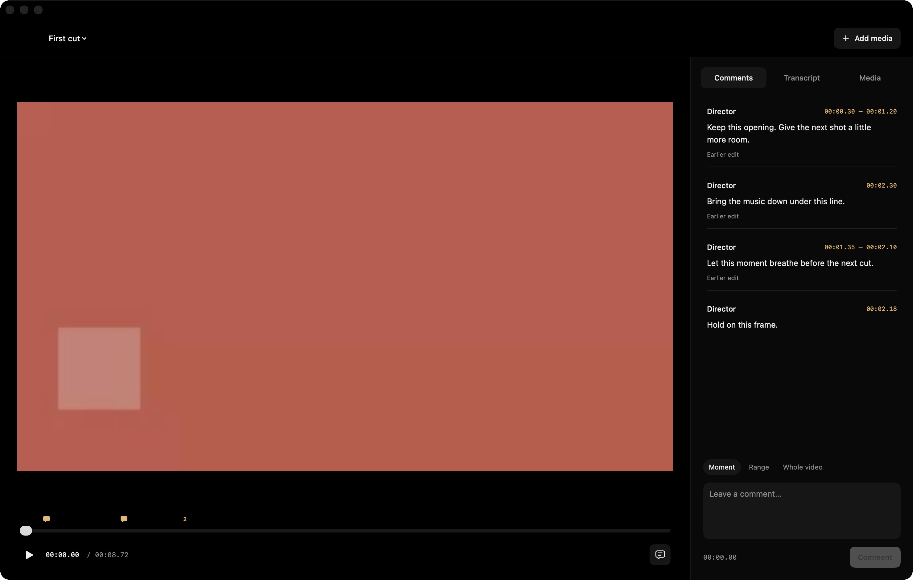

# Verification · v0.2

Verified locally on Apple M4 Max, macOS 26.6.2, Xcode 27.1 / Swift 6.4. The fixtures are generated locally; no private user footage was used. The Mac app is a local ad-hoc signed release build, not a notarized public release.

## Automated checks

`./scripts/test.sh` passes **39 Swift tests** (including three H.264/HEVC/ProRes cases within the export-preset test) and **20 external CLI / JSON API / MCP checks**, plus **15 plugin/project lifecycle checks**.

The core tests cover rational time, half-open boundaries, source/sequence time mapping, ripple edits across layers, independent audio settings, input rejection, atomic rollback, revision conflicts across independent database connections, exact-batch retry behavior, historical restores, source anchoring, feedback lifecycle, transcript selection, voiceover fallback, and ambiguous repeated words.

The media tests generate a native H.264 movie with two separately identifiable audio tracks (440 Hz and 880 Hz). They check actual decoded pixels, sample amplitudes, and export metadata. Coverage includes:

- a real ripple edit changes picture and exported duration;
- muting one embedded track removes only its tone, including after MP4 export;
- transcript deletion changes actual video/audio length;
- historical feedback returns original frames and audio after the working cut changes;
- native EQ attenuates the expected tone;
- source audio offsets and big-endian AIFF decoding remain correct;
- still images, title-only intervals, black gaps, overlays, speed, portrait framing, and color affect rendered output;
- each advertised export preset produces its expected native codec;
- in-flight export pins its revision, changed sources fail, and existing files are preserved.

The smoke script launches real external processes. It creates/imports/edits a project, deletes timed words, mutes a source stream, grades/reformats, exports a portrait MP4, and probes that file through a second project. It then exercises JSON request IDs/errors and MCP initialization, schemas, real inline PNG/WAV content, stale-revision rejection, invalid-argument rejection without mutation, and a preview job polled to completion.

The new tests cover explicit project routing, missing-project errors, no-overwrite creation, registry persistence/deduplication, removed/ambiguous comment markers, and paths containing spaces. `scripts/test-plugins.py` launches the exact plugin MCP command without a project, creates two projects, verifies their isolation, reads actual PNG/WAV review context, restarts the server, and checks CLI/API bootstrap. It also passed against the packaged release helper.

## Real local speech

The v0.1 speech acceptance run of `python3 scripts/test-speech.py <bundled-direction-cli> build/verification` passed; the speech engine was unchanged in v0.2. It ran with Apple's on-device SpeechAnalyzer. A phrase generated by macOS `say` produced **27 timed words**. Deleting a recognized word shortened the sequence by that word's exact recognized interval. This is an integration test against the local speech service, separate from deterministic timed-transcript fixtures. First use on another Mac may need a language-model download.

## Native window checks · v0.2

The packaged release app was checked through native accessibility and screenshots with `build/verification/JetBlack.direction`, a separate fixture project. Existing user review edits were preserved.

| Check | Observed result |
| --- | --- |
| Viewer and navigation | Jet-black viewer, one seek bar, Comments / Transcript / Media; no layered timeline or finishing tabs |
| Range note | Entering 1.35–2.10 seconds and saving created a visible marker and a persisted range of exactly 0.75 seconds |
| Marker click | Seeks to exactly 1.35 seconds, selects the matching card, and opens the comment's original revision when needed |
| Multimodal context | The UI note is returned through tools with two source anchors, captured transcript, original revision, frames, and audio |
| Transcript edit | Deleting “local” and applying shortened the actual sequence from 8.839002 to 8.719002 seconds and removed that timed word |
| Overlapping markers | A count menu lists both nearby comments; selecting one seeks to its individual start |
| Marker projection | A comment at 2.30 seconds moved to 2.18 on the new cut while retaining its original reviewed timestamp |
| Media | Thumbnail library renders; Add media opens the native file picker |
| Projects | New/open/recent project actions are available; direction_open_project(showInApp:true) launched the native document successfully |
| Plugins | Both Codex and Claude Code installed direction@direction-local; Claude manifest validation and all three skill validations pass |

The native range fields and clickable marker actions were exercised. Mouse dragging on the scrubber is implemented by SwiftUI's native Slider; the automation surface's coordinate-input limitation prevents claiming a mouse-drag acceptance test. Frame-region annotations remain in the tool contract but are no longer a director UI control.



## Reproduce and inspect

```sh
./scripts/test.sh
./scripts/build-app.sh release
python3 scripts/smoke.py build/Direction.app/Contents/Helpers/direction build/verification/two-track-source.mov build/verification
python3 scripts/test-plugins.py build/Direction.app/Contents/Helpers/direction build/verification/two-track-source.mov
python3 scripts/test-speech.py build/Direction.app/Contents/Helpers/direction build/verification
codesign --verify --deep --strict build/Direction.app
```

Machine-readable evidence is in `build/verification/smoke-report.json`, `plugin-report.json`, `v02-ui-report.json`, `v02-ui-feedback.json`, and `v02-ui-context.json`. Earlier speech evidence is retained in `speech-report.json`. The new hands-on project is `build/verification/JetBlack.direction`. Build/test media and caches are deliberately excluded from Git.

These checks prove the implemented local workflow on small deterministic sources. They do not qualify sustained 4K multicam playback, large project memory usage, all camera codecs, Intel Macs, HDR workflows, speech accuracy on diverse real recordings, or public app distribution. Those remain explicit follow-up work.
